<p align="center">
  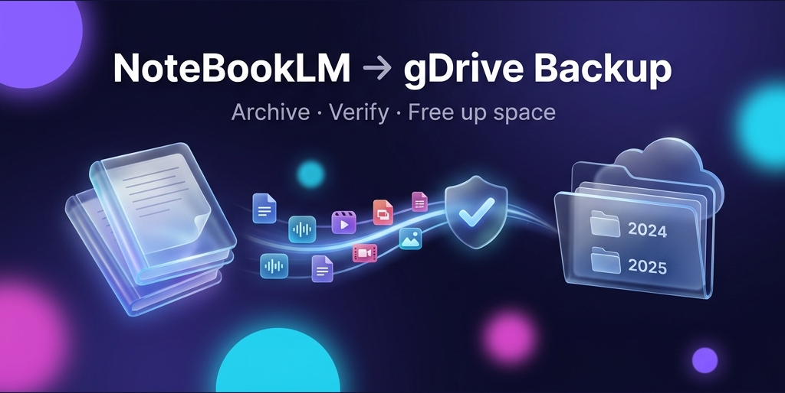
</p>

<p align="center">
  
  
  
  
  
  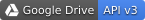
  
  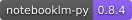
  
  <br>
  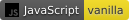
  
  
  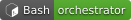
  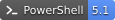
  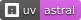
  
  
  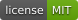
  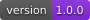
</p>

# 🚀 NoteBookLM-TO-gDrive Backup (`nlm2drive`)

Back up your NotebookLM notebooks to **Google Drive as browsable folders**. Every file is **verified in the cloud (MD5)**. Only then is the notebook **deleted from NotebookLM**, allowing you to free up space and bypass the 500-notebook limit seamlessly.

Runs locally in **Docker** with a sleek **Web UI** for selecting notebooks and monitoring progress. Everything is automated by a single orchestrator script (`nlm2drive.sh` or `nlm2drive.cmd`).

> **Status:** `v1.0.0`, working end-to-end on Windows 11 + Docker Desktop + Google Workspace.
> Built on the unofficial [notebooklm-py](https://github.com/teng-lin/notebooklm-py) library (MIT, pinned at `0.8.4`).

---

## 📸 Web UI Dashboard
*(Manage backups, switch between Table & Grid views, filter by year/month/topic, inspect notebook contents, and safely archive to Drive)*

<p align="center">
  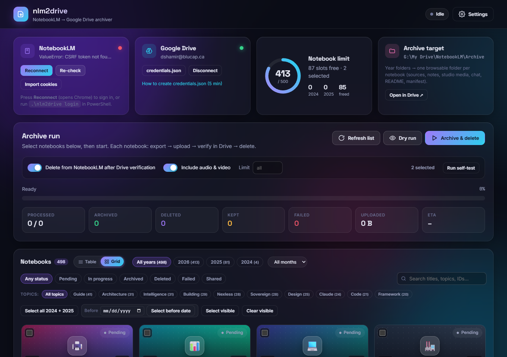
</p>

### ✨ UI Features
- 🗂️ **Grid & Table Views**: Seamlessly switch between a compact tabular view and visual card tiles with generative cover art.
- 🎨 **Generative Cover Art Thumbnails**: Deterministic mesh gradients paired with custom floating 3D emoji badges and status indicators.
- 🔎 **Multi-Dimensional Search**: Dynamic Year chips with live counts, Month selector (`Jan`–`Dec`), and auto-clustered Topic chips.
- 📊 **Real-time Quota Gauge & Capacity Monitor**: Visual capacity meter tracking account usage against the 500-notebook quota with safety badges (Green/Amber/Red) and total Drive storage counter.
- ⚡ **Quick Cleanup Presets**: 1-click pills for `Empty Drafts (0 sources)`, `Stale (>6 mo)`, `Oldest 25`, and `Oldest 50` plus `Select Filtered` button.
- 🔁 **1-Click "Restore to NotebookLM"**: Reconstitute deleted or archived notebooks back into NotebookLM with original text sources intact.
- 📑 **Catalog Export & Drive Auditor**: Export full inventory as CSV/JSON and audit Google Drive folder integrity with bounded parallel verification.
- 🎧 **In-Modal Content Preview & Audio Player**: Inspect backed-up text sources/notes and stream audio overview podcasts directly in the dashboard.
- 🔔 **Desktop Notifications**: HTML5 browser and Windows notification alerts for completed runs and auth-needed pauses.
- 📅 **Date Cutoff Batch Selection**: Select and batch archive notebooks created before any specified date (e.g. freeing early 2026 slots).
- 🔍 **In-App Notebook Inspector**: 1-click modal viewing full metadata, verification status, file breakdowns, and studio artifact counts.
- ↗️ **Direct Links**: One-click opening of the live notebook in NotebookLM (`↗ Live`) or Google Drive (`📁 Drive`).

---

## 📂 What you get

Your backups are converted into clean, browsable folders on Google Drive (`My Drive/NotebookLM/Archive/<Year>/<Title> (<id>)/`, or `G:\My Drive\NotebookLM\Archive\` with Google Drive for Desktop):

```text
My Drive/NotebookLM/Archive/            (= G:\My Drive\NotebookLM\Archive with Drive for Desktop)
├── _catalog.md / _catalog.csv          # Index of every archived notebook (status, size, link)
├── 2024/
│   └── My research (3c775e3c)/
│       ├── README.md                   # Summary, source table, links to everything below
│       ├── metadata.json               # Notebook metadata + export stats
│       ├── manifest.json               # SHA256 + MD5 + size of every file (used for verification)
│       ├── sources/01 - <title>.md …   # Full extracted text of each source (+ index.json)
│       ├── notes/*.md                  # Saved notes (+ index.json)
│       ├── studio/
│       │   ├── audio/*.m4a             # Audio Overview podcasts
│       │   ├── video/*.mp4             # Video Overviews
│       │   ├── slides/*.pdf + *.pptx   # Slide Decks (both PDF and PowerPoint)
│       │   ├── reports/*.md            # Briefing Docs, Study Guides, FAQs, Reports
│       │   ├── infographics/*.png      # High-res Infographics
│       │   ├── mind-maps/*.json        # Interactive & note-backed Mind Map node trees
│       │   ├── quizzes/*.json + *.md   # Quizzes (structured JSON + readable Markdown)
│       │   ├── flashcards/*.json + *.md# Flashcards (structured JSON + readable Markdown)
│       │   ├── data-tables/*.csv       # Data Tables
│       │   └── index.json              # Full Studio artifact inventory
│       └── chat/history.md + history.json
└── 2025/…
```

---

## 🛠️ Requirements
- 💻 **Windows 10/11** with **Docker Desktop**.
- 🧰 **Git for Windows** (provides Git Bash; `nlm2drive.cmd` uses it) or WSL.
- 🌐 **Google Chrome** (or Edge) for the one-time NotebookLM sign-in. [`uv`](https://docs.astral.sh/uv/) is installed automatically.
- 🔑 A **Google Cloud OAuth "Desktop app" client** for Drive. *(It's free and takes ~5 minutes. See below)*.

---

## ⚡ Quick start

From **PowerShell / cmd** use `.\nlm2drive <command>`. From Git Bash/WSL use `./nlm2drive.sh <command>`.

```powershell
.\nlm2drive setup     # starts Docker Desktop if needed, builds the image
.\nlm2drive login     # opens Chrome on Google sign-in → session saved to data/notebooklm
.\nlm2drive up        # starts the stack and opens http://localhost:8765
```

### 🎛️ Using the Web UI
1. **Google Drive** card: Upload `credentials.json`, then press **Connect**.
2. Press **Refresh list**. All owned 2024 + 2025 notebooks are pre-selected *(years are configurable in Settings)*.
3. **Dry run** to preview, then do a trial **archive-only** run: switch deletion off and set Limit = 1.
4. Type **`DELETE AFTER BACKUP`** in the red banner, set Limit = 3, then **Archive & delete**. Check the results, clear Limit, and run again.

---

## 🛡️ Safety guarantees

- 🔒 A notebook is deleted **ONLY** if every one of these holds true:
  1. Its Drive folder was just re-listed and **every file's MD5 and size match** the local manifest.
  2. The export was **complete** (any source/studio item that exists but failed to download means it is archived but **kept**).
  3. Deletion is enabled for the run, **and** the one-time typed confirmation was given.
- 🤝 **Shared** notebooks (where you aren't the owner) are never touched.
- 🔄 Interrupted runs resume safely. Half-done notebooks restart, and an interrupted delete is re-checked.
- 🛑 After 5 failures in a row the run auto-pauses *(usually an expired session)*.
- 🧠 Only read, download, and delete endpoints are called. **No AI generation, so no NotebookLM quota is used.**
- 🔐 The UI is bound to `127.0.0.1` only. Secrets live in `data/`, which is git-ignored.

---

## 🔄 If the NotebookLM session expires
Google can revoke the NotebookLM browser session during a long run. **Nothing is lost**: the run pauses, the pill turns red (**Sign-in needed**), and no notebook is marked failed.

1. Press **Reconnect NotebookLM** (red banner, or the *Reconnect* button on the NotebookLM card) and sign in to Google in the Chrome window that opens.
2. That's it. The page notices the new session and the run continues with the same notebook.

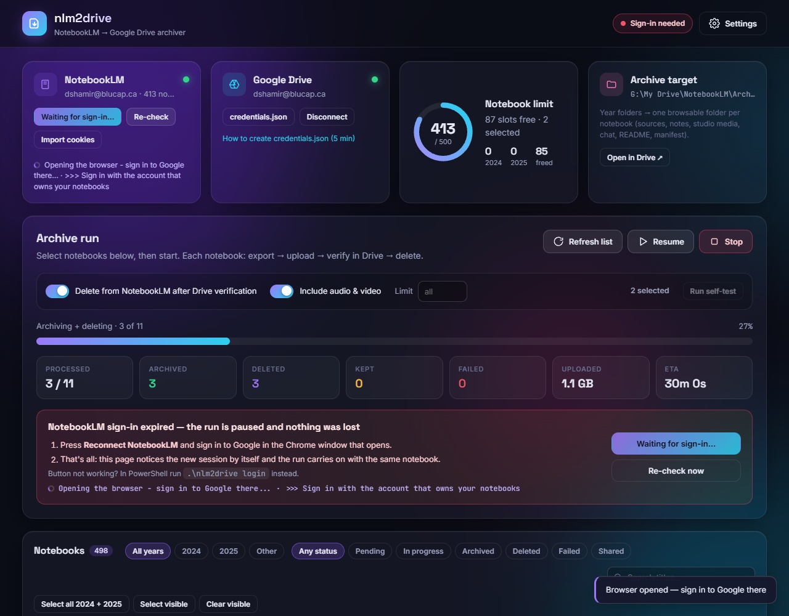

> NotebookLM has no OAuth / public API (only Drive does), so the renewal is a normal Google sign-in in Chrome. The button works through a small, loopback-only, token-protected helper that `.\nlm2drive up` starts on your PC ([ADR-011](docs/DECISIONS.md)). Without it, run `.\nlm2drive login` (or `.\nlm2drive helper start` once, or `.\nlm2drive helper install` to start it at every Windows logon).

---

## 🔑 Google Drive OAuth client (one time)

1. [Create a project](https://console.cloud.google.com/projectcreate) and enable the [Google Drive API](https://console.cloud.google.com/apis/library/drive.googleapis.com).
2. Under [Audience](https://console.cloud.google.com/auth/audience):
   - With a **Google Workspace** account, choose **Make internal**. There's no verification and tokens don't expire.
   - Otherwise, press **Publish app → In production**. *(Leaving it in Testing causes Error 403, and tokens expire in 7 days)*.
3. Under [Clients](https://console.cloud.google.com/auth/clients), choose **Create client → Desktop app → Download JSON**.
4. Upload the JSON in the UI and press **Connect**. 
   *(For an External app, Google shows "Google hasn't verified this app"; choose **Advanced → Go to … (unsafe)**. It's your own app.)*

---

## ⌨️ CLI Commands

| Command | Purpose |
|---|---|
| `setup` | Create `data/` folders, start Docker, build the image |
| `login [--browser chrome\|msedge] [--fresh]` | NotebookLM sign-in. `--fresh` wipes the profile to switch accounts |
| `helper start\|stop\|status\|install\|uninstall` | The host-side listener behind the UI's **Reconnect** button (`up`/`down` manage it; `install` = start at Windows logon) |
| `up` / `down` / `restart` / `logs` / `open` / `status` | Manage the Docker stack |
| `run [--dry-run] [--no-delete] [--limit N]` | Start a run headlessly; watch it in the UI |
| `refresh` | Refresh the NotebookLM session cookies |
| `e2e` | Self-test with a throwaway notebook |
| `test` | Run the unit tests in the container |
| `lint` / `typecheck` | `ruff` / `mypy` in the container (config in `pyproject.toml`) |
| `smoke` | Read-only live checks against the running stack (no NotebookLM/Drive calls) |
| `check` | All gates: lint → typecheck → tests → smoke (smoke only if the stack is up) |

---

## 📚 Documentation

| Doc | Contents |
|---|---|
| [docs/ARCHITECTURE.md](docs/ARCHITECTURE.md) | Components, data flow, state machine, API, data layout |
| [docs/DECISIONS.md](docs/DECISIONS.md) | Design decisions and why (ADR log) |
| [docs/OPERATIONS.md](docs/OPERATIONS.md) | Runbook: daily use, re-login, upgrades, reset, backup |
| [docs/TROUBLESHOOTING.md](docs/TROUBLESHOOTING.md) | Every problem hit so far and its fix |
| [AGENTS.md](AGENTS.md) | Continuity notes for future maintainers and AI coding agents |
| [CHANGELOG.md](CHANGELOG.md) | Release history |

---

## ⚠️ Limits
- NotebookLM does not expose the original uploaded files (PDFs etc.). Their **full extracted text** is saved instead. URL, YouTube, and Drive sources keep their link or ID.
- `notebooklm-py` uses undocumented Google endpoints. If Google changes them, update the pin (see [OPERATIONS](docs/OPERATIONS.md#upgrading-notebooklm-py)).

## 📄 License
[MIT](LICENSE). Not affiliated with Google.
