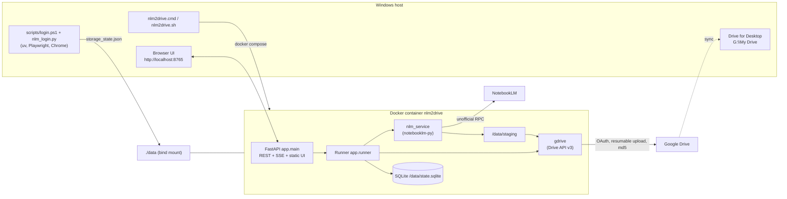
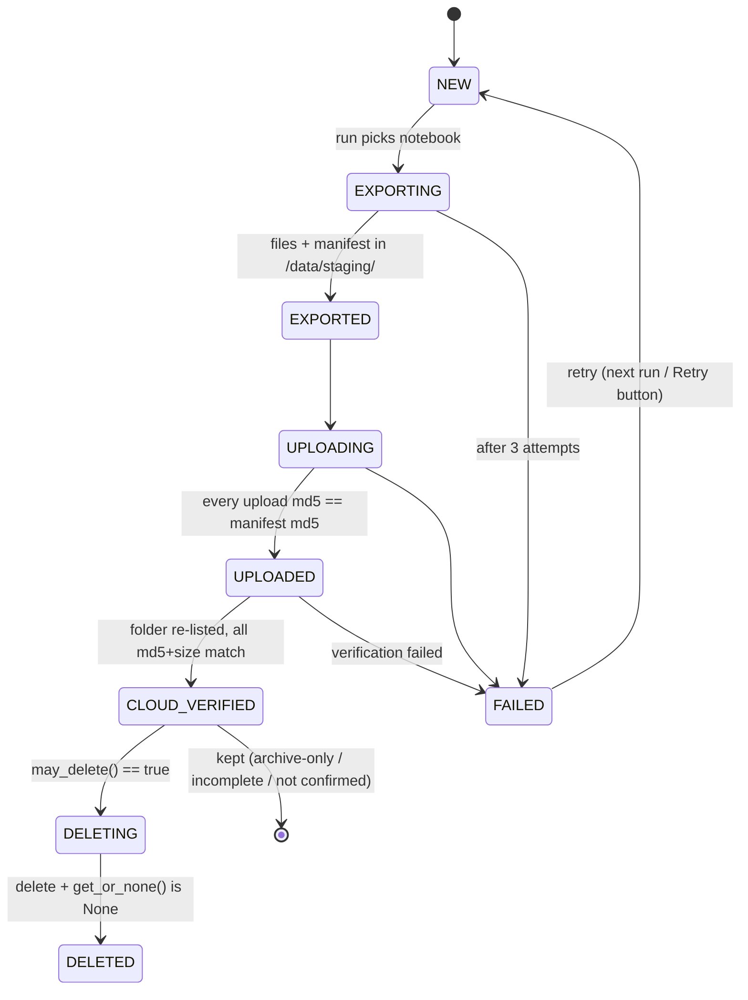
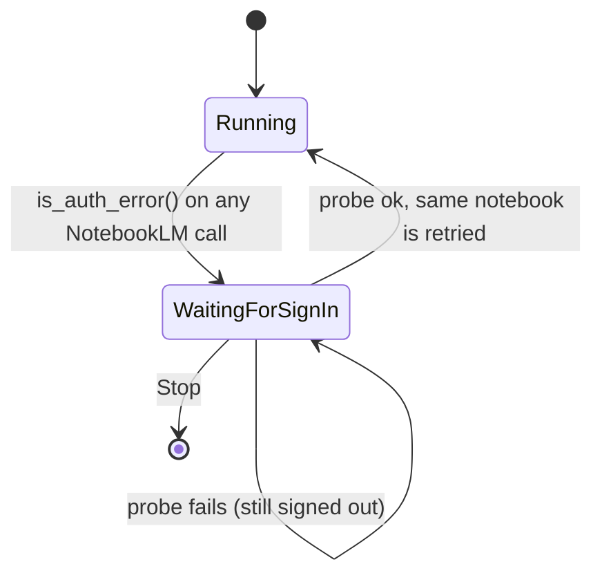

# Architecture

## Overview



## Components

| File | Responsibility |
|---|---|
| `app/config.py` | Environment paths (`DATA_DIR=/data`) and user `Settings`, persisted in `/data/config.json` |
| `app/state.py` | SQLite `StateDB`: `notebooks` (stage machine), `runs`, `events`. Selection rules |
| `app/nlm_service.py` | NotebookLM: list, **full export** to a staging folder, delete (+ confirm gone), test-notebook creation |
| `app/archive.py` | Windows/Drive-safe naming, sha256+md5 hashing, `manifest.json`, `_catalog.md/csv` rendering |
| `app/gdrive.py` | Drive OAuth (web flow via the UI), folder management, resumable uploads (>5 MB, 16 MB chunks), folder verification |
| `app/runner.py` | The pipeline, pause/stop, retries, auto-pause, crash recovery, and **`may_delete` (the only deletion gate)** |
| `app/main.py` | FastAPI: REST endpoints, SSE `/api/events`, OAuth callback, cookie import, static UI |
| `app/static/*` | Vanilla HTML/CSS/JS dashboard (dark glass design), live via Server-Sent Events |
| `scripts/login.ps1` | Host-side sign-in: detects the default browser, installs `uv`, runs `nlm_login.py`, verifies with `notebooklm auth check --test` |
| `scripts/nlm_login.py` | Playwright persistent-profile login. Waits for Google `SID` + `__Secure-1PSIDTS`, then saves `storage_state.json` |
| `nlm2drive.sh` | Orchestrator (setup/login/up/down/run/...). Uses Docker Desktop's `docker.exe`, starts the engine if needed |
| `nlm2drive.cmd` | Windows launcher: runs `nlm2drive.sh` through Git Bash (fallback: WSL) |

## Per-notebook pipeline (stage machine)



- **Crash recovery:** on startup, `EXPORTING/EXPORTED/UPLOADING/UPLOADED` reset to `NEW`. `DELETING` is resolved by checking whether the notebook still exists.
- **Re-runs:** a `CLOUD_VERIFIED` notebook is **re-verified** against the stored expected-md5 map (`cloud_detail.expected`) before deletion. If its source count changed since archiving, it is re-archived.
- **Partial uploads:** a stale folder with the same name is moved to the Drive trash before uploading again.
- **Incomplete exports** (`IncompleteExport`): retried once. If content is still missing, what exists is archived with `complete=0`, and the notebook is never deleted.

## NotebookLM session expiry (pause-and-recover)
Google can revoke the NotebookLM web session mid-run (see ADR-010). It is handled as a *run-level* condition, never as a notebook failure:



- `nlm_service.is_auth_error()` classifies errors (typed `AuthError`, `rpc_code 16`, `unauthenticated`, CSRF/SNlM0e extraction failures, redirect-to-login). It walks the cause chain and deliberately ignores rate limits (`resource exhausted`) and network errors.
- The exporter's tolerant `except` blocks re-raise auth errors (`_reraise_if_auth`), so an expired session is never mistaken for "one source failed" (which would have produced an incomplete export).
- `Runner._process_with_retries` does **not** retry an auth error. It rolls the notebook back (`EXPORTING..UPLOADED` → `NEW`; `CLOUD_VERIFIED/DELETING` keep their stage), leaves `attempts`/`failed` untouched and raises `SessionExpired`.
- `Runner._recover_session` sets `state=paused, needs_auth=true`, clears `current`, and waits. It re-probes (`_open_probed`: new client + one `notebooks.list()`) when the user presses Re-check/Resume, when `storage_state.json` changes (a new sign-in), or every 5 min. On success the run continues with the **same** notebook.
- The run also probes the session **before** the first notebook (fail fast) and on every reconnect.
- While a run owns the session, `/api/auth/status` and `/api/auth/reload` report the runner's view and `/api/refresh` returns 409: a second NotebookLM client would rotate `__Secure-1PSIDTS` concurrently with the run.
- On startup, notebooks that were marked FAILED only because of an expired session (`StateDB.reset_auth_failures`) are put back in the queue.

## Export contents (`nlm_service.export_notebook`)
| Item | API | Saved as |
|---|---|---|
| Metadata + summary | `notebooks.get_summary` | `metadata.json`, `README.md` |
| Sources | `sources.list`, `sources.get_fulltext(markdown→text)` | `sources/NN - title.md` + `index.json` (type, URL, Drive ID) |
| Notes | `notes.list` | `notes/*.md` + `index.json` |
| Studio artifacts | `artifacts.list`, `download_*` | audio `.m4a`, video `.mp4`, report `.md`, slides `.pdf`, infographic `.png`, quiz/flashcards `.json+.md`, data table `.csv`, mind map `.json` |
| Note-backed mind maps | `mind_maps.list/get_tree` | `studio/mind-maps/*.json` |
| Chat | `chat.get_history` | `chat/history.json` + `history.md` |
| Integrity | — | `manifest.json` (sha256, md5, size per file) |

## HTTP API (`app/main.py`)
| Method | Path | Purpose |
|---|---|---|
| GET | `/api/health` | liveness (Docker healthcheck) |
| GET | `/api/summary` | run status, counts, settings, cached connection status |
| GET | `/api/notebooks` | all notebooks with stage/stats |
| POST | `/api/notebooks/select`, `/api/notebooks/select-years` | selection (owned only) |
| POST | `/api/notebooks/{id}/retry` | FAILED → NEW + select |
| POST | `/api/refresh` | list the account → upsert into DB |
| POST | `/api/run` | `{dry_run, delete, limit, ids}` |
| POST | `/api/pause`, `/api/resume`, `/api/stop` | run control |
| POST | `/api/test-e2e` | throwaway notebook archive → verify → delete |
| GET/POST | `/api/settings` | user settings |
| POST | `/api/confirm-delete`, `/api/revoke-delete` | typed deletion confirmation |
| GET | `/api/events` (SSE), `/api/events/history`, `/api/runs` | live feed, log, run history |
| GET/POST | `/api/auth/status`, `/api/auth/reload`, `/api/auth/import` | NotebookLM session (cookie JSON import supported). During a run: runner's view, and a nudge to a run waiting for sign-in |
| GET/POST | `/api/drive/status`, `/api/drive/credentials`, `/api/drive/connect`, `/api/drive/callback`, `/api/drive/disconnect` | Drive OAuth |

## Data directory (`./data` → `/data`, git-ignored, **contains secrets**)
```
data/
├── notebooklm/profiles/default/storage_state.json   NotebookLM cookies (secret)
├── notebooklm/profiles/default/browser_profile/     Chrome profile used for sign-in (secret)
├── google/credentials.json                          OAuth client (secret)
├── google/token.json                                Drive refresh token (secret)
├── state.sqlite                                     stages, runs, events
├── config.json                                      settings (incl. delete_confirmed)
├── staging/<notebook-id>/                           temporary export (removed after verification)
└── logs/
```

## Tests
`tests/` uses a fake NotebookLM client and an in-memory Drive (`tests/conftest.py`). The in-memory Drive reuses the real `DriveClient.verify_folder`. The fake NotebookLM can simulate a revoked Google session (`session_ok`, `expire_on_export`, `auth_fail_fulltext`). The tests cover deletion gating, incomplete exports, md5 retry, verification failure, dry run, limit, crash recovery, re-verification before delete, the full `may_delete` policy matrix, and session expiry (pause without failures, resume of the same notebook, Resume while still signed out, Stop while waiting, refusing to start on a dead session, auth-error classification, re-queueing of auth-failed rows). Run them with `.\nlm2drive test`.

**Quality gates** (`.\nlm2drive check`): `ruff` (config and justified ignores in `pyproject.toml`), `mypy` over `app/` and `scripts/`, the pytest suite, and `scripts/smoke.py`, which probes a *running* stack read-only (health, summary shape, list endpoints, static assets) without calling NotebookLM or Drive.
